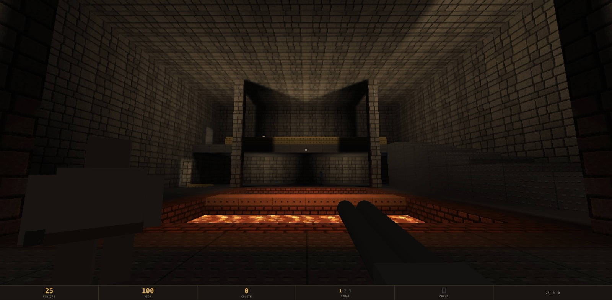

# Strata

An original 3D first-person shooter in plain JavaScript and three.js. Rooms
above rooms, baked light and shadow, air strafing and rocket jumps. No build
step, no dependencies to install, no asset files: every texture, model and
sound is made in code.

**Play it:** https://ciro-maciel.github.io/strata/

[Português](README.pt-BR.md)



## Run it

```bash
git clone https://github.com/ciro-maciel/strata
cd strata
python3 -m http.server 8000   # or any static server
```

Open http://localhost:8000. It needs a server only because browsers do not
load ES modules from `file://`. It needs WebGL 2.

## Controls

| Key | Action |
|---|---|
| W A S D | Move |
| Mouse | Aim |
| Click (or Ctrl) | Fire |
| Space | Jump (hold it to hop) |
| Shift | Walk |
| 1 2 3, mouse wheel | Weapons |
| Esc | Pause |

Doors open as you walk up to them. The secret ledge in the courtyard is five
units up: jump, look down and fire a rocket.

## What is inside

Strata studies how the 1996-era 3D shooters worked and rebuilds the ideas on
three.js:

- **Real 3D levels** from a voxel grid, carved by a short program.
- **Baked light and shadow**: rays from every light to every voxel, stored in
  a 3D texture the world shader reads; models are lit by it too.
- **The classic movement**: ground friction, acceleration, gravity, step
  climbing and the air acceleration cap that makes air strafing and bunny
  hopping work, with the original numbers.
- **Knockback and splash damage**, so rockets push and rocket jumps happen.
- **Warping lava, a two-layer scrolling sky, dynamic lights, particles.**
- **Monsters** that think ten times a second: the warden fires a shotgun,
  the stalker leaps, the hurler lobs bouncing grenades, and they fight each
  other when one hurts another.

[docs/ENGINE.md](docs/ENGINE.md) explains the original design and every place
this one differs. The name, monsters, art, sound and level are original.

## Make a level

A level is a function in [src/levels.js](src/levels.js): start from rock,
`room()` carves a space and paints its walls, `fill()` adds stairs, ledges
and pools, and entities place lights, monsters, items, doors and lifts.

`node --test test/*.test.js` walks the level the way a player can and checks
that the key and the exit can be reached, that the exit needs the key, and
that the secret ledge really needs a rocket jump.

## Tests

```bash
node --test test/*.test.js
```

## License

MIT, see [LICENSE](LICENSE). three.js is MIT, loaded from a CDN; see
[NOTICE](NOTICE).

Made by [Ciro Cesar Maciel](https://ciromaciel.click/?ref=oss-strata).
