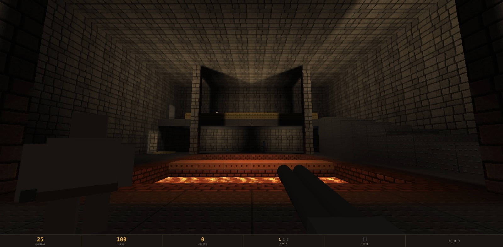

# Strata

Um jogo de tiro em primeira pessoa 3D original, em JavaScript puro e
three.js. Salas sobre salas, luz e sombra pré-calculadas, air strafing e
rocket jump. Sem etapa de build, sem dependência para instalar, sem arquivo
de arte: toda textura, modelo e som é feito em código.

**Jogue:** https://ciro-maciel.github.io/strata/

[English](README.md)



## Rodar

```bash
git clone https://github.com/ciro-maciel/strata
cd strata
python3 -m http.server 8000   # ou qualquer servidor estático
```

Abra http://localhost:8000. O servidor só é preciso porque o navegador não
carrega módulos ES a partir de `file://`. Precisa de WebGL 2.

## Controles

| Tecla | Ação |
|---|---|
| W A S D | Andar |
| Mouse | Mirar |
| Clique (ou Ctrl) | Atirar |
| Espaço | Pular (segure para emendar pulos) |
| Shift | Andar devagar |
| 1 2 3, roda do mouse | Armas |
| Esc | Pausar |

As portas abrem quando você chega perto. A plataforma secreta do pátio fica
cinco unidades acima do chão: pule, olhe para baixo e atire um foguete.

## O que tem dentro

O Strata estuda como funcionavam os jogos de tiro 3D da época de 1996 e
reconstrói as ideias sobre o three.js:

- **Fases em 3D de verdade**, numa grade de voxels esculpida por um programa
  curto.
- **Luz e sombra pré-calculadas**: raios de cada luz até cada voxel,
  guardados numa textura 3D que o shader do mundo lê; os modelos também são
  iluminados por ela.
- **O movimento clássico**: atrito no chão, aceleração, gravidade, subida de
  degrau e o limite de aceleração no ar que faz o air strafing e o bunny hop
  funcionarem, com os números originais.
- **Empurrão e dano de explosão**, para o foguete empurrar e o rocket jump
  existir.
- **Lava que ondula, céu de duas camadas, luzes dinâmicas, partículas.**
- **Monstros** que pensam dez vezes por segundo: o warden atira de escopeta,
  o stalker salta, o hurler arremessa granadas que quicam, e eles brigam entre
  si quando um machuca o outro.

O [docs/ENGINE.md](docs/ENGINE.md) explica o desenho original e cada ponto em
que este é diferente. Nome, monstros, arte, som e fase são originais.

## Fazer uma fase

Uma fase é uma função em [src/levels.js](src/levels.js): começa da rocha,
`room()` esculpe um espaço e pinta as paredes, `fill()` põe escadas, beirais
e poços, e as entidades colocam luzes, monstros, itens, portas e elevadores.

O `node --test test/*.test.js` percorre a fase como um jogador pode e confere
que a chave e a saída são alcançáveis, que a saída precisa da chave e que a
plataforma secreta só se alcança com rocket jump.

## Testes

```bash
node --test test/*.test.js
```

## Licença

MIT, veja [LICENSE](LICENSE). O three.js é MIT, carregado de uma CDN; veja
[NOTICE](NOTICE).

Feito por [Ciro Cesar Maciel](https://ciromaciel.click/?ref=oss-strata).
